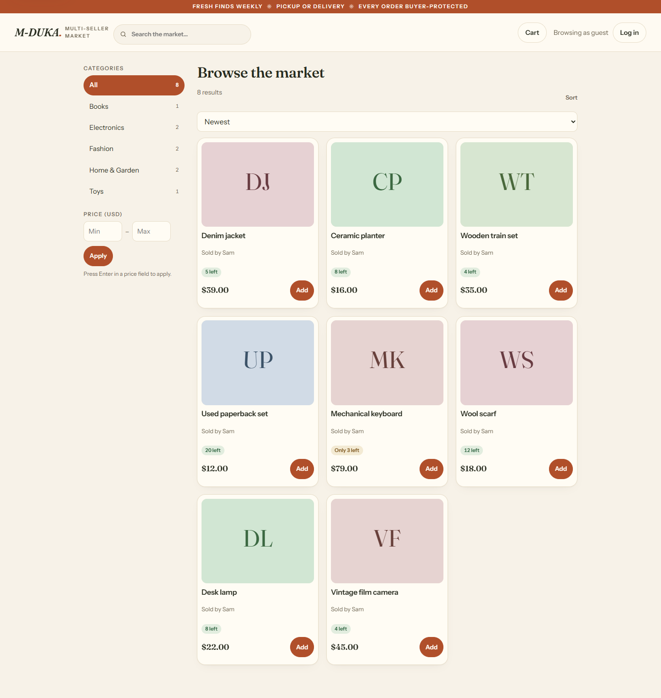
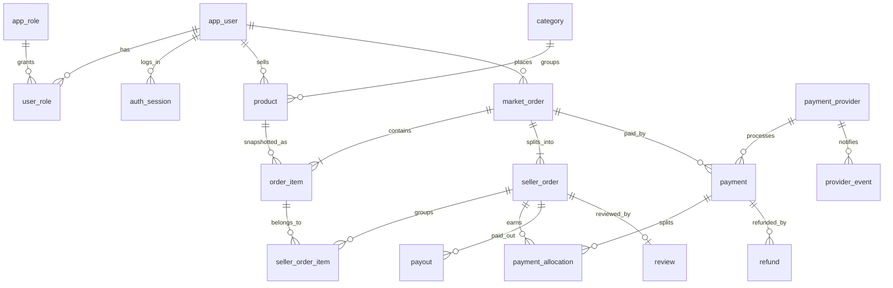
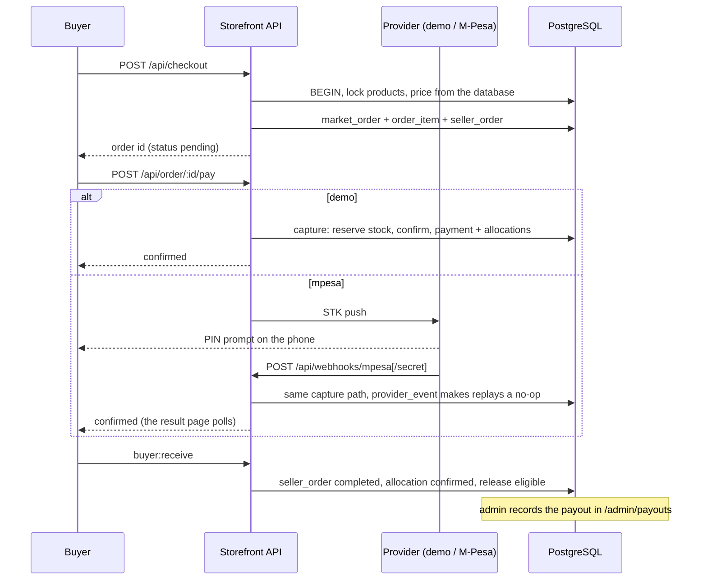
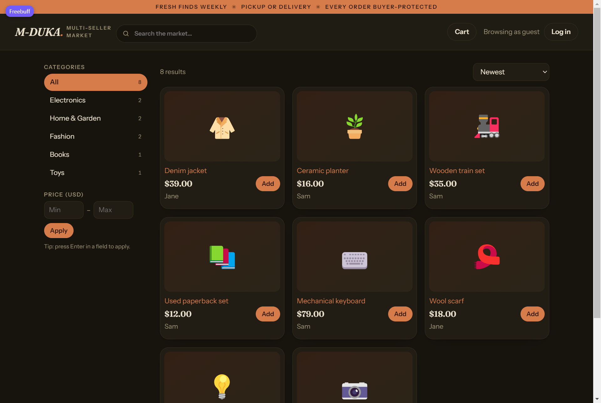
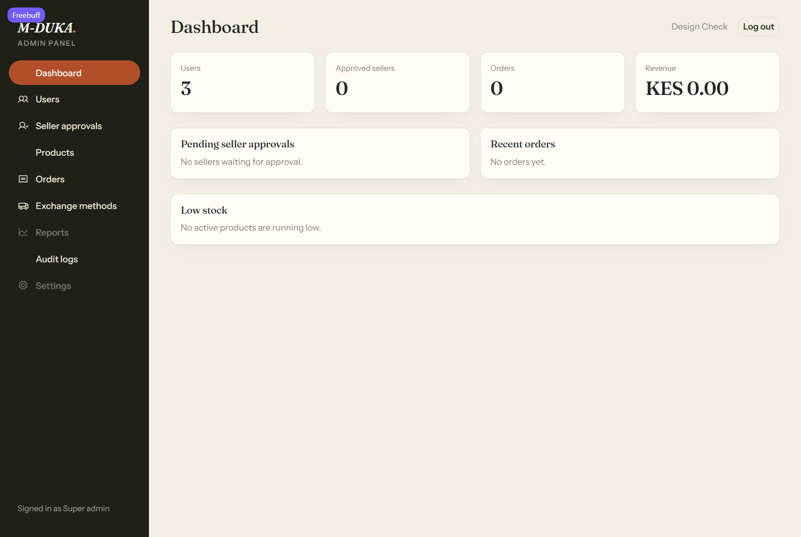
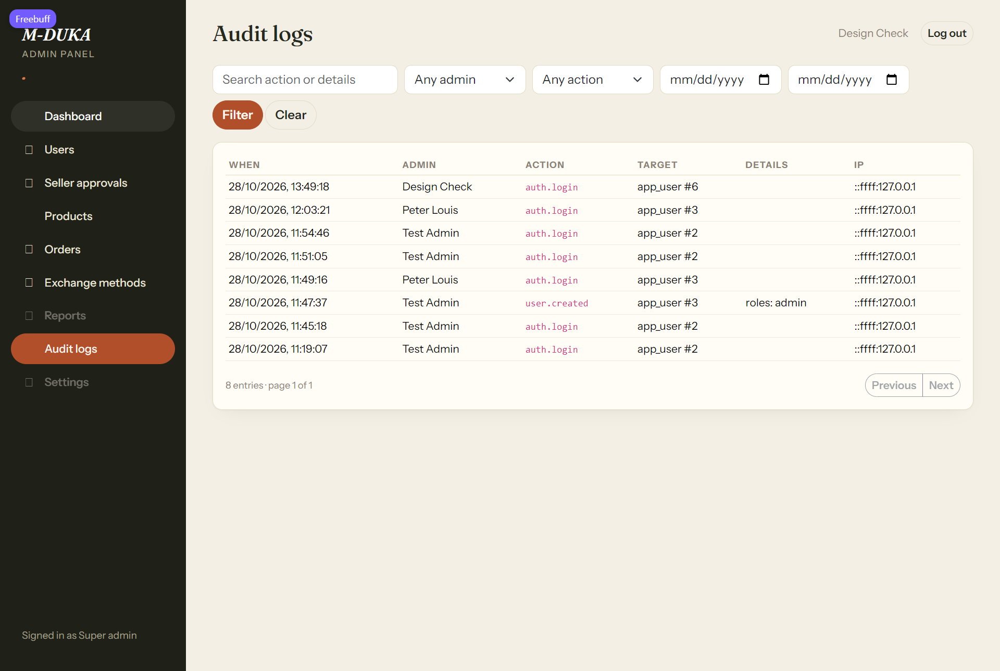

# M-DUKA — multi-seller marketplace

A small but complete marketplace: buyers browse and check out, a single checkout is split
across several sellers, sellers fulfil their own slice, and money is tracked per seller all
the way from payment to payout. It runs on Node, Express and PostgreSQL, with a vanilla
JavaScript storefront and an EJS admin panel.



## What it does

**Buyers** — browse and search the catalogue, filter by category and price, cart, check out
with a delivery address and one exchange method per seller, pay (simulated or M-Pesa), follow
each seller's slice of the order, cancel an unpaid order, confirm receipt, request a refund,
and review a seller once an order is complete.

**Sellers** — become a seller from the storefront, create and edit listings (draft, active,
paused), watch incoming orders, confirm or decline, mark shipped with a tracking number, and
see revenue, units and top listings.

**Admins** (`/admin`) — dashboard, user search and management (suspend, roles, approval,
reset links), product and category moderation with an audit trail, the full order pipeline,
a payout queue, a printable sales report with its own filters, in-app help, optional TOTP
two-factor sign-in, exchange methods, and audit logs. Super admins additionally manage exchange
methods and audit logs and can act on admin accounts.

Every privileged change writes an `audit_log` row **in the same transaction** as the change.

## How it is put together

```text
            ┌──────────────────────────────┐
  browser ──┤ src/server.ts (one node http)│
            └──────┬───────────┬───────────┘
                   │           │
        /api/*     │           │    /admin/*
                   ▼           ▼
        ┌────────────────┐  ┌─────────────────┐
        │ storefront API │  │ admin EJS app   │
        │ src/api        │  │ src/admin       │
        └───────┬────────┘  └────────┬────────┘
                │  shared session    │
                └─────────┬──────────┘
                          ▼
                 PostgreSQL (src/db.ts)
```

Both Express apps share one `auth_session` table and one `sid` cookie, so signing in on the
storefront also signs you in to `/admin`. What you may do is decided by `app_role` /
`user_role`, never by which app you came through.

```
src/
  server.ts              path routing, health check, session cleanup, sweeps
  db.ts                  pooled + unpooled Postgres clients
  env.ts                 env parsing and validation
  migrate.ts             base schema, then numbered SQL/*.sql once each
  api/index.ts           all storefront endpoints
  api/payments/mpesa.ts  Daraja client (OAuth, STK push, callback parsing)
  admin/                 Express app, auth guard, routes, EJS views
  public/index.html      the storefront SPA (single file)
  scripts/               admin + demo seeders
SQL/                     schema and numbered migrations
scripts/                 stress test and contrast checks
```

## The order model

A checkout is not one row. It is:

- one `market_order` — buyer, total, delivery address, checkout status;
- one `order_item` per product, carrying **price snapshots** (a later price change never
  rewrites history);
- one `seller_order` per distinct seller, plus `seller_order_item` links.

Fulfilment, refunds and payouts hang off `seller_order`. The checkout status is derived:
the API rolls it up whenever a seed order moves (buyer receipt, seller decline), and the
admin panel does the same when it moves one by hand.



Postgres enforces the parts that matter: money is integer minor units, every enum is a
`CHECK`, `order_item.line_total = quantity * unit_price`, a seller order's items must all
belong to the same checkout and the same seller, a review requires a completed seller order,
and posted ledger rows are immutable.

## Payment flow



Stock is reserved **at capture**, in the same transaction as the payment row, with a
`quantity_available >= qty` guard — two buyers can never capture the last unit. Unpaid
checkouts are cancelled after 30 minutes, and an unanswered STK prompt after 15.

## Running it

```bash
npm install
cp .env.example .env      # or create .env with DATABASE_URL
npm run migrate           # base schema + every SQL/NNN_*.sql once
npm run demo:seed         # optional: demo users, listings and orders
npm run admin:seed        # optional: an admin account
npm run build && npm start
```

`.env` needs `DATABASE_URL` (pooled) and usually `DATABASE_URL_UNPOOLED`. Optional:
`PORT` (default 3000), `APP_CURRENCY` (default USD), `DATABASE_SSL=true`,
`PAYMENT_PROVIDER=demo|mpesa`, `TRUST_PROXY=true`, `NODE_ENV=production`.

Storefront: `/` · Admin: `/admin` · Health: `/health`

Real M-Pesa through the Daraja sandbox — free developer account, no business registration —
is documented in [INSTALL.md](INSTALL.md#real-m-pesa-payments-daraja-sandbox).

Demo accounts after `demo:seed`: `jane@example.com` (buyer) and `sam@example.com` (seller),
password `password123`.

## Interface

| | |
|---|---|
|  |  |
|  |  |
|  |  |

## Testing

`npm run build` type-checks everything. `scripts/stress-test.mjs` drives the running app
(auth, catalogue, checkout, payment, seller transitions) against `BASE_URL`, and
`scripts/check-contrast.mjs` checks the palette. Both are manual harnesses rather than a
test runner; runs are pointed at a scratch database, never at demo data.

## Documentation

`README.md` (this file) explains the architecture and the money model, `INSTALL.md` covers
setup, M-Pesa and the Docker image, `docs/USER_MANUAL.md` walks through the storefront, seller
and admin flows, and `docs/PRESENTATION.md` is the demo script for the final presentation. The admin panel also has a built-in **Help** page at `/admin/help`, and **Reports** at
`/admin/reports` produces a printable sales report with company header, period, filters,
sorting and generation time.

## Money is recorded, not moved

The app is honest about where automation stops:

- **Payments** are real with `PAYMENT_PROVIDER=mpesa` (sandbox), simulated otherwise.
- **Refunds** are recorded (`refund`, allocation reversed, payment and order updated) but the
  money is returned in the provider's dashboard. A refund is refused once the seller has been
  paid out.
- **Payouts** are queued automatically when a buyer confirms receipt, and an admin records the
  provider reference when the transfer is made.

`ledger_*`, `dispute` and `seller_payment_account` exist in the schema as scaffolding and are
not used by the application.

## Known limitations

- The storefront loads the catalogue once and filters in the browser; `/api/products`
  supports server-side `q`, `category`, `min` and `max`, which the UI does not call yet.
- `GET /api/orders` returns the newest 50 orders by default (`limit`/`offset` up to 200).
- No email or notification delivery: password resets are issued as links by an admin.
- Login lockouts and the signup/payment rate limits are in-memory, so they reset on restart and
  are per process.
- One currency per deployment is assumed for display; `/seller/stats` sums line totals
  without grouping by currency.
- Listings with zero stock stay `active` and read as "Sold out" rather than flipping to `sold`.
